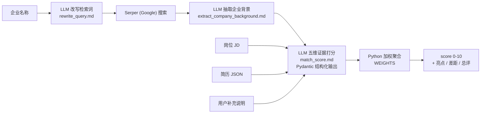

# Resume-Match

> 输入「岗位 JD + 企业名称 + 结构化简历」，服务自动联网调研企业背景，由 LLM 完成五个维度的证据化评估，最终由代码按权重聚合出 0–10 的匹配分与诊断报告。

核心思路：**检索 → 抽取 → 结构化评估 → 确定性聚合**。总分不由单次 prompt 直接生成，而是由程序对五个维度的子分加权计算，保证评分过程可控、可审计。

## 效果示例

同一份 NLP / 大模型方向的简历，分别匹配两类岗位：

| 岗位类型 | 总分 | 结论摘要 |
|---|---|---|
| 大模型 Agent 算法岗 | 8.65 / 10 | 硬技能与经验高度匹配，学历为主要风险点 |
| CV 视觉算法岗（要求 C++ / TensorRT） | 3.25 / 10 | 无 CV 经验、缺 C++，硬技能维度存在严重缺口 |

两类岗位的得分差超过 5 分，评分对岗位差异具备区分度，而非集中在中间分数段。

## 架构



### 设计要点

1. **检索词改写，不直接搜索企业名**：企业名称先经 LLM 标准化补全，并改写为面向求职场景的检索词（公司简介、成立时间、团队规模、融资情况等）；改写失败时自动降级为兜底查询语句。
2. **证据先行的结构化打分**：每个维度按 `evidence → reason → status → score` 的固定顺序产出，证据必须引用简历或 JD 原文，无证据则标记"缺失"并降低分数。输出格式由 Pydantic 模型（`Literal` 状态枚举 + `ge/le` 分数边界）配合 `with_structured_output` 强约束。
3. **总分由代码计算**：LLM 仅输出五个 0–10 的维度子分，总分由程序按 `WEIGHTS` 权重表加权求和。权重可调整、结果可复算，避免大模型计算总分时引入的算术误差。
4. **全链路兜底与可观测**：每一步 JSON 解析失败均有降级路径；loguru 日志按 info / error 双文件分流（9 MB 轮转、保留 30 天），关键阶段带耗时埋点。

### 评分维度与权重

| 维度 | 评估内容 | 权重 |
|---|---|---|
| `hard_skill` | 编程语言、框架、工具、技术栈是否匹配 JD | 0.35 |
| `experience` | 工作年限、项目复杂度、岗位职责相关性 | 0.30 |
| `company_fit` | 结合企业背景评估候选人与公司的契合度 | 0.20 |
| `education` | 学历、专业、证书等硬性门槛 | 0.10 |
| `soft_fit` | 稳定性、潜力、软技能等加减分因素 | 0.05 |

## 项目结构

```
Resume-Match/
├── app.py                          # Streamlit 演示界面（复用 src/ 核心逻辑）
├── requirements.txt
├── utils.py                        # LLM 客户端、计时装饰器、根路径
├── logger.py                       # loguru 日志配置（stdout + info.log + error.log）
├── gunicorn.py                     # gunicorn 配置（2 worker × 4 线程，timeout 180s）
├── entry/
│   └── server.py                   # Flask 入口：/healthy /resume/match /search
├── src/
│   ├── search.py                   # 企业背景调研：改写 → Serper 搜索 → LLM 抽取
│   └── match.py                    # 五维打分 + WEIGHTS 加权聚合
├── Prompt/
│   ├── rewrite_query.md            # 企业名 → 检索词
│   ├── extract_company_background.md  # 搜索结果 → 求职者视角的企业背景 JSON
│   └── match_score.md              # 五维证据打分
├── Data/                           # 简历 JSON 数据目录
└── logs/                           # 运行日志（已 gitignore）
```

## 快速开始

### 1. 安装依赖

需要 Python 3.10 及以上版本。

```bash
pip install -r requirements.txt
```

### 2. 配置 .env（项目根目录）

```ini
API_KEY_DOUBAO=火山方舟 ARK API Key
SERPER_API_KEY=serper.dev API Key
Tavily_API_KEY=tavily.com API Key
```

说明：

- **LLM**：默认使用火山方舟（豆包）的 OpenAI 兼容接口，`utils.py` 中的 `model` 为推理接入点 ID（`ep-...`），需替换为自己的接入点；如需切换其他 OpenAI 兼容服务，修改 `base_url` 与 `model` 即可。
- **SERPER_API_KEY**：联网检索的主链路，走 Google 搜索。
- **Tavily_API_KEY**：`src/search.py` 导入时会初始化 Tavily 客户端，因此需要配置；当前检索主链路不经过它。

### 3a. 启动 Web 演示（Streamlit）

```bash
streamlit run app.py
```

浏览器打开 `http://localhost:8501`。两个标签页分别对应两个 API 能力：完整简历匹配、独立企业背景调研。

### 3b. 启动 API 服务（Flask + gunicorn）

```bash
gunicorn -c gunicorn.py entry.server:app
```

服务监听 `0.0.0.0:8999`。

## API 文档

### GET /healthy

健康检查。

```json
{"code": 0, "info": "Success"}
```

### POST /resume/match

完整匹配管线：企业背景调研 + 五维打分 + 加权总分。

请求体：

```json
{
    "name": "阿里巴巴",
    "job_description": "岗位职责与任职要求全文…",
    "resume_json": { "见下方简历 JSON 格式": "…" },
    "user_input": "可选的补充说明，如期望薪资、到岗时间等"
}
```

成功响应：

```json
{
    "code": 0,
    "info": "success",
    "data": {
        "strengths": ["匹配亮点1", "匹配亮点2"],
        "gaps": ["差距或风险1", "差距或风险2"],
        "overall_reason": "综合总评，3-5 句话",
        "score": 7.55
    }
}
```

失败响应：`{"code": 1, "info": "failed", "data": "<traceback 文本>"}`

### POST /search

独立的企业背景调研。

请求体：`{"name": "阿里巴巴"}`

成功响应：

```json
{
    "code": 0,
    "info": "success",
    "data": {
        "公司简介": "互联网行业头部企业，业务覆盖电商、云计算等领域…",
        "成立时间": "1999 年，约 27 年",
        "公司规模": "…",
        "融资出资": "…",
        "主营业务": "…",
        "发展阶段": "成熟期，已上市…",
        "求职参考点": "…"
    }
}
```

检索不到的字段如实填"未知"，不做编造。失败响应与 `/resume/match` 一致：`{"code": 1, "info": "failed", "data": "<traceback 文本>"}`

### 耗时说明

参考耗时：企业背景调研约 20~100 秒，五维打分约 1~2 分钟，单次完整匹配约 1.5~3.5 分钟（联网检索 + 多次 LLM 调用，未做缓存与并行）。gunicorn 的 `timeout=180` 据此设置。

## 简历 JSON 格式

简历以结构化 JSON 传入，整个 JSON 会序列化后注入打分 prompt，**字段结构不做强制限定**，以下仅为参考示例：

```json
{
    "基本信息": {"姓名": "张三", "电话": "138****0000", "邮箱": "zhangsan@example.com"},
    "求职意向": {"目标职位": "AI 算法工程师", "工作经验": "3 年"},
    "教育背景": {"时间": "2015-2019", "学历": "本科", "学校": "某大学", "学位": "学士"},
    "工作经历": [
        {
            "公司名称": "某科技公司",
            "职位": "算法工程师",
            "工作时间": "2021-2025",
            "工作职责": ["负责…", "基于 Python/PyTorch…"]
        }
    ],
    "技能清单": {"编程语言": {"Python": "熟练掌握"}},
    "其他信息": "…",
    "项目经验": "…"
}
```

## 声明

本项目用于学习与技术演示。评分结果由大模型生成，仅供参考，不构成任何招聘或求职决策依据。
